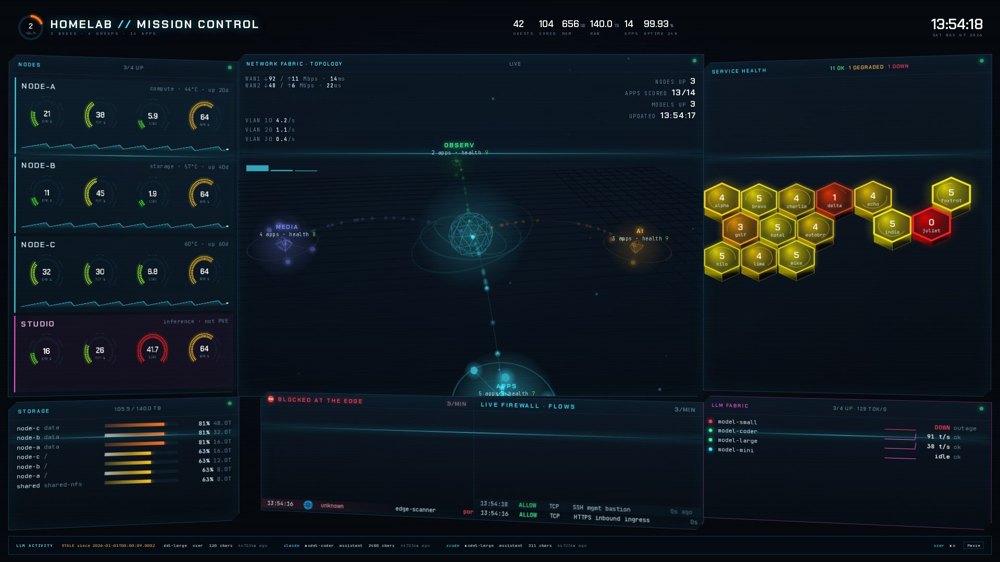
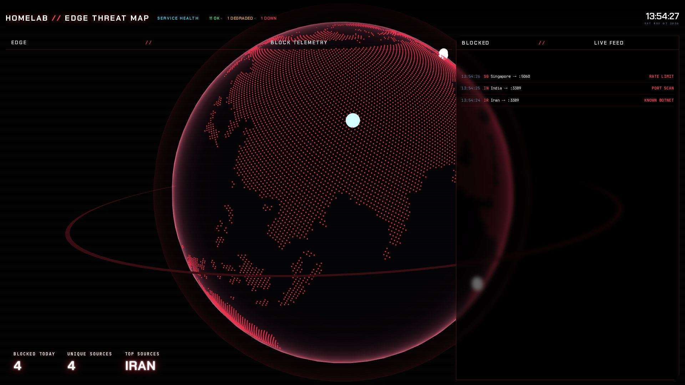
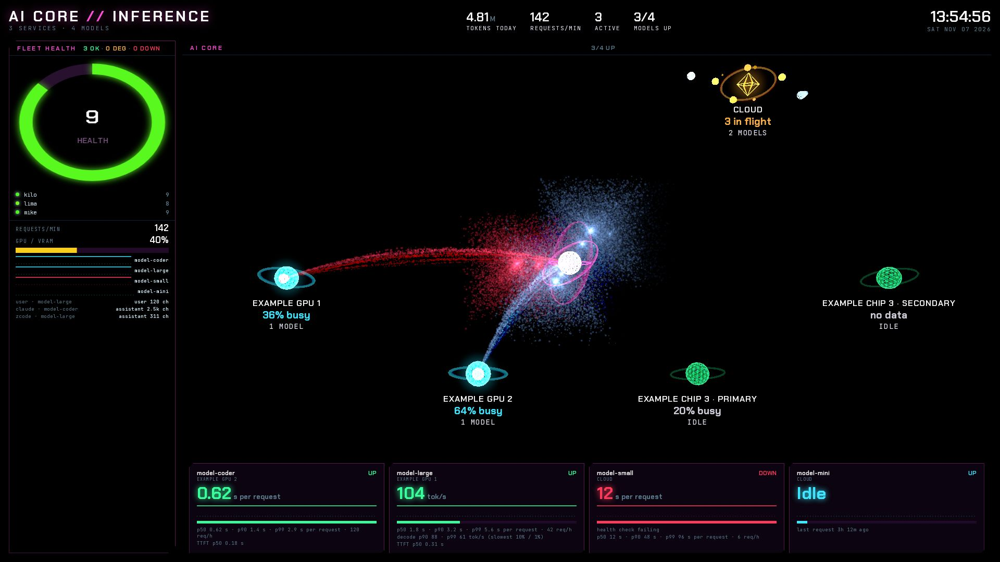
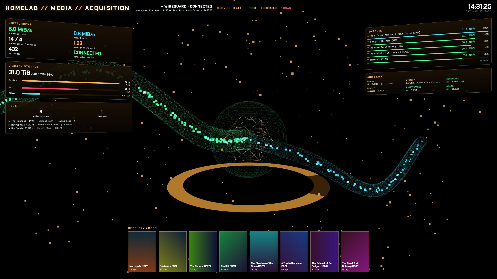
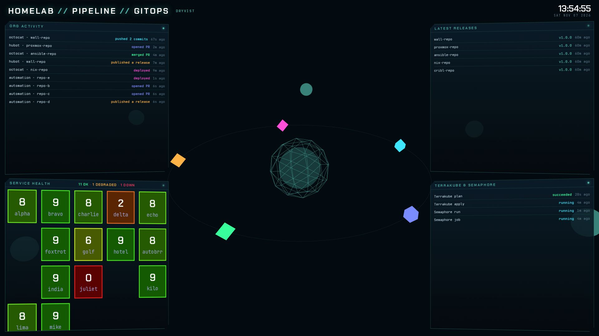
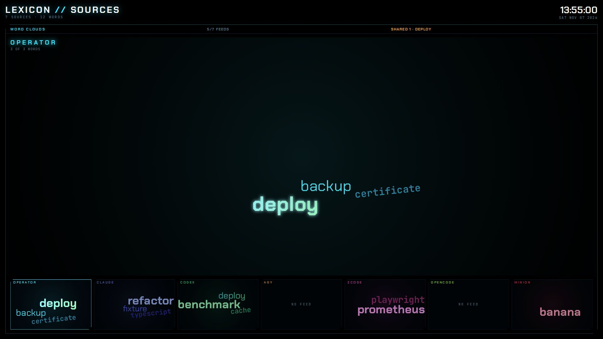
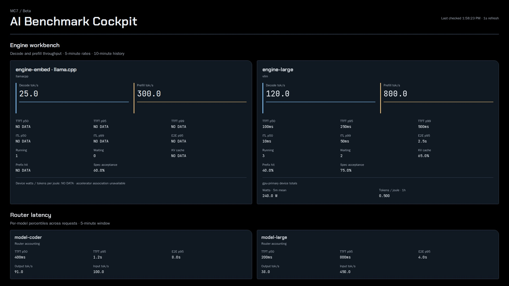
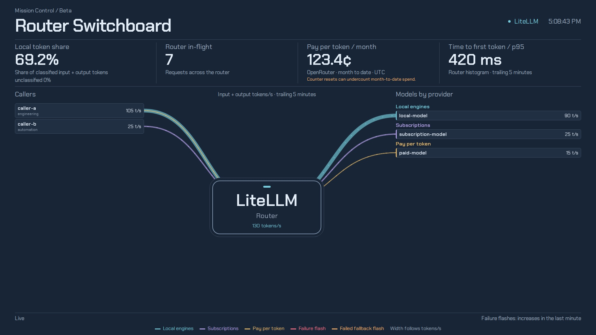
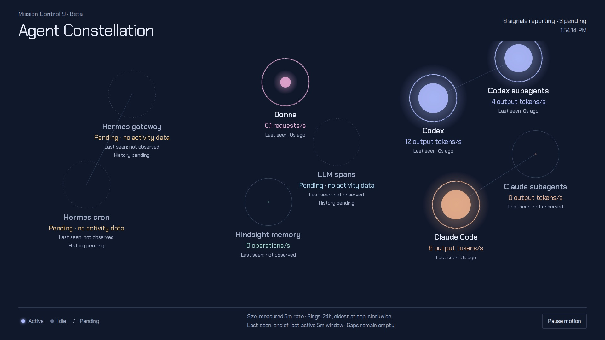

# homelab-wall

Static wall-display pages for a homelab and its AI fleet, rotated full screen, for anyone who runs a 24/7 kiosk
display of their estate.

[](https://github.com/dryvist/homelab-wall/actions/workflows/ci.yml)
[](LICENSE)

## Requirements

- A modern browser with WebGL. MC3 also uses WebGPU where the browser has it.
- For development: Node.js (the long-term support release) and Python 3.
- Optional: Nix with direnv, for the development shell in `flake.nix`.

## Installation

Run it locally from a clone:

```sh
git clone https://github.com/dryvist/homelab-wall.git
cd homelab-wall
npm ci
node scripts/vendor-three.mjs
cat > site/config.json <<'EOF'
{
  "title": "HOMELAB",
  "refreshSeconds": 15,
  "nodeRoles": {"node-a": "compute"},
  "groups": [{"name": "apps", "apps": ["alpha", "bravo"]}]
}
EOF
python3 -m http.server 4173 --bind localhost --directory site
```

- Every page reads `/config.json` at start. Git ignores `site/config.json`.
- With no Prometheus gateway or snapshot behind it, the pages show stand-in content.

Deploy a release:

- Each [release](https://github.com/dryvist/homelab-wall/releases) attaches `homelab-wall-site.tar.gz` and its
  `homelab-wall-site.tar.gz.sha256`.
- The tarball holds the contents of `site/` at its root. Extract it into the web root.
- The deployment adds `/config.json`, and serves either a read-only Prometheus gateway at `/api/prom/` or a snapshot
  file.
- The deployment also serves `/api/words` for MC6 and `/api/llm/recent` for MC1 and MC3, on the same origin.
- [The runtime contract](docs/runtime-contract.md) states the shape of each.

## Usage

Open the rotator, or a single page:

```sh
open http://localhost:4173/          # the rotator; use xdg-open on Linux
open http://localhost:4173/mc3/      # one page, /mc1/ to /mc9/
open 'http://localhost:4173/?gl=2d'  # force 2D rendering; ?gl=3d forces 3D
```

- Open `/` full screen on a 1920×1080 display. The rotator cycles the pages, or the `slides` list in `config.json`.
- [The rotator page](docs/rotator.md) covers the default order, the controls and the reload rules.
- Each page refreshes its data every `refreshSeconds` in `config.json`, 15 seconds by default.

Snapshot mode reads every query from one static file instead of `/api/prom`. Add its path to `config.json`:

```json
{"snapshot": "/data/snapshot.json"}
```

- The pages poll the snapshot file at most every 2 seconds.
- The file holds one entry per key in `site/queries.json`. [The runtime contract](docs/runtime-contract.md) shows its
  shape.

## Pages

The rotator shows these pages in this order.

### MC1 · Mission Control

The estate overview: nodes, network topology, service health, storage, firewall activity and the large language model
(LLM) router, with recent LLM requests along the bottom.



Details: [docs/mc1.md](docs/mc1.md).

### MC2 · Edge

An edge threat map: a full-screen globe behind a service health strip and two edge block panels.



Details: [docs/mc2.md](docs/mc2.md).

### MC3 · AI Core

The AI inference core: a hub with four device nodes and a cloud node, fleet health, and cards for the models with
real recent requests.



Details: [docs/mc3.md](docs/mc3.md).

### MC4 · Media

Media acquisition: a 3D acquisition flow behind download, library, playback and media-service cards.



Details: [docs/mc4.md](docs/mc4.md).

### MC5 · GitOps

The GitOps pipeline of the `dryvist` GitHub organization: repositories, events, releases and service health.



Details: [docs/mc5.md](docs/mc5.md).

### MC6 · Lexicon

One word cloud per source, the operator and each AI agent, with a hero cloud that cycles through them.



Details: [docs/mc6.md](docs/mc6.md).

### MC7 · AI Benchmark Cockpit

Engine and router benchmarks: throughput, latency percentiles, cache, concurrency and device power.



Details: [docs/mc7.md](docs/mc7.md).

### MC8 · Router Switchboard

Token flow from each caller, through the LLM router, to each model, grouped by billing class.



Details: [docs/mc8.md](docs/mc8.md).

### MC9 · Agent Constellation

AI agent activity as a constellation: each signal's 5-minute rate, ringed by its last 24 hours.



Details: [docs/mc9.md](docs/mc9.md).

## Development

```sh
direnv allow                                       # optional: the Nix development shell
npm ci
node scripts/vendor-three.mjs                      # generate site/vendor/three
npx tsc --noEmit                                   # typecheck
node --test 'tests/*.test.js' 'tests/*.test.mjs'   # unit tests
npx playwright install chromium webkit
npx playwright test                                # end-to-end tests
```

- Playwright serves `site/` with `python3 -m http.server` on port 4173 and runs every spec against fixture data.
- It runs eight projects, Chromium and WebKit at each size:
  - `chromium-1920x1080@1` and `webkit-1920x1080@1`: 1920×1080 at device pixel ratio (DPR) 1;
  - `chromium-1920x1080@2` and `webkit-1920x1080@2`: 1920×1080 at DPR 2;
  - `chromium-2560x1440` and `webkit-2560x1440`: 2560×1440;
  - `chromium-1440x900` and `webkit-1440x900`: 1440×900.
- Run one project with `npx playwright test --project=webkit-1920x1080@2`.
- Continuous integration (CI) runs each project as its own job.
- Set `WALL_URL` to run the suite against a deployed wall. The `live` project then also runs `tests/wall.live.spec.ts`.
- After changing `site/lib/queries.js`, run `node scripts/gen-queries.mjs`. CI fails when `site/queries.json` is out
  of date.
- After changing the `three` version, run `node scripts/vendor-three.mjs` again. Git ignores `site/vendor/three`. CI and
  the release workflow generate it.

Layout:

- `site/index.html` and `site/rotator/`: the rotator.
- `site/mc1/` to `site/mc9/`: one folder per page.
- `site/lib/`: the Prometheus client, the queries and health score, and shared stage and render helpers.
- `site/vendor/` and `site/fonts/`: generated three.js (not committed), vendored d3-cloud and fonts.
- `site/sw.js`: the service worker that keeps the wall bootable while the origin is down.
- `scripts/`: the query allow-list generator and the three.js vendoring script.
- `tests/`: Playwright specs and unit tests, against fixture data.
- `docs/`: one page per wall page, plus the rotator and the runtime contract.

## Contributing

Commit, branch and pull request conventions are in the
[public conventions](https://docs.jacobpevans.com/conventions/overview).

## License

[Apache-2.0](LICENSE).

---

> Part of a [larger ecosystem of repos](https://docs.jacobpevans.com): see how it all fits together.
