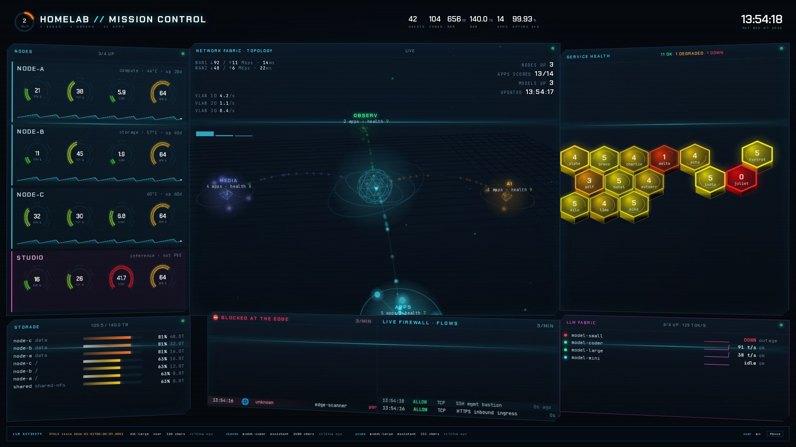

# MC1 · Mission Control

MC1 is the estate overview. It shows configured nodes, a full-page network topology behind the panels, service health,
storage, WAN rates and the large language model (LLM) router, with recent LLM requests along the bottom. The header
title comes from `config.json` `title` and defaults to `HOMELAB`.

## Panels

- Header: an estate health ring, a subtitle with node, group and app counts, six key figures and a clock.
  - The ring shows the lowest score among scored apps, so the estate never reads healthier than its worst app.
  - The key figures are guests (`config.json` `guestCount`), cores, memory in GB, raw storage in TB, apps, and
    24-hour uptime.
- Nodes: one card per node in `config.json` `nodeRoles`, in reverse name order, then one card per `extraNodes` entry.
  - Each card shows central processing unit (CPU), memory and load gauges, a graphics processing unit (GPU) gauge,
    and a 30-minute CPU sparkline.
  - Each node has its own GPU gauge. Once GPU inventory is available, a node with no GPU shows `NO GPU`.
  - The card subtitle shows the role, the hottest temperature and the uptime in days.
  - A role that only repeats the node's own name is left out of the subtitle.
  - The panel title counts nodes up out of all nodes.
- Network fabric · topology: one cluster per `config.json` group and hubs for returned VLAN metrics.
  - The topology fills the page behind the panels. WAN rates come from UniFi WAN byte counters.
  - VLAN hubs use client byte rates. Each network and VLAN pair is its own hub, named with its VLAN.
  - Labels show group app counts and health, nodes up, apps scored, models up and the last update time.
  - On a software WebGL renderer the topology drops to a 2D mode, labelled `2D MODE`. `?gl=3d` or `?gl=2d` forces
    either.
- Service health: a honeycomb of every app in `config.json` `groups`, in group order, with one empty cell between
  groups.
  - An app listed in two groups appears in the first one.
  - Each cell shows the app's health score from 0 to 10.
  - The title counts apps OK (8 or more), DEGRADED (5 to under 8) and DOWN (under 5).
- Storage: pool and filesystem rows, largest first, each with node, pool or mount name, percent used and size.
  - A pool is counted once per node.
  - The same device and mountpoint reported by several nodes is one row, labelled `shared`.
  - Network and virtual filesystems are excluded by the query.
  - All pools are included. If the rows do not fit, the panel shows a `+N more` count.
  - Sizes from 900 GB through 1 TB display as `1T`.
  - The title shows used and total TB.
- Firewall: the `Blocked at the edge` and `Live firewall · flows` columns have no feed and show `No feed`.
- LLM fabric: up to 9 router models, sorted by state, then output tok/s, then name.
  - It lists only models with real requests in the last 4 days. The router's own health-check caller does not count.
  - When that query fails, it lists every deployment instead.
  - Each row shows a state dot, the model name, a token-rate sparkline, output tok/s and the state `ok`, `degraded`
    or `outage`.
  - The title shows local and cloud model counts and rates separately.
- LLM activity ribbon: the 24 newest router requests, newest first, scrolling along the bottom.
  - MC1's activity ribbon reads `/api/llm/recent` once per minute, using metadata only: `ts` (Coordinated Universal
    Time), `source`, `model`, `role`, and `chars`.
  - It accepts a row array or ClickHouse JSON's `data` array.
  - Size means exact characters, never tokens.
  - The feed has no per-request token counts, generation rate, or time to first token, so the ribbon does not
    display those measurements.
  - Pause stops its motion; reduced motion allows manual scrolling.

## Data

- `appScore`: the health score per app, for the honeycomb, the ring and the topology clusters.
- `uptime24h`: the percentage of successful health checks over 24 hours, for the uptime figure.
- `nodeCpu`: CPU busy percent per node. MC1 also reads it as a 30-minute range at 30-second steps for the sparkline.
- `nodeCores`: core count per node.
- `nodeMem`: memory used percent per node.
- `nodeMemTotal`: total memory per node.
- `nodeLoad`: the 1-minute load average per node.
- `nodeTemp`: the hottest hardware-monitor temperature per node.
- `nodeUptime`: seconds since boot per node.
- `acceleratorBusy`: busy percent per accelerator, averaged over 5 minutes. Every GPU gauge shows the busiest one.
- `fsSize`: filesystem size in bytes.
- `fsAvail`: filesystem free bytes.
- `pveStorageUsed`: pool usage by storage identifier.
- `llmState`: the router deployment state per model: 0 ok, 1 degraded, 2 outage.
- `llmUsed4d`: models with a real request in the last 4 days. Only these models get a row.
- `llmTokRate`: output tok/s per model over 5 minutes.
- `wanRxBytes` and `wanTxBytes`: receive and transmit byte rates from the WAN counters.
- `vlanRxBytes` and `vlanTxBytes`: client receive and transmit byte rates, grouped by network and VLAN.

The ribbon reads `/api/llm/recent`, outside Prometheus. Its contract is in [the runtime contract](runtime-contract.md).

## States

- Pending:
  - A node without current metrics keeps its card and shows pending or its last real values as stale.
  - Missing GPU readings show `—`; a node without a GPU shows `NO GPU`.
  - The LLM fabric is pending until readings arrive and shows its query message when a query fails.
- Idle: a model at 0.05 tok/s or less reads `idle`. A model in outage reads `DOWN`.
- STALE:
  - A node that drops out of a single poll shows a stale state instead of disappearing.
  - It keeps its last known values, dims, and is labelled `STALE <age>`, then `STALE since <time>` after about
    5 minutes.
  - The last known values survive a page reload.
  - The node set itself always comes from `config.json` (`nodeRoles` and `extraNodes`), never from whichever series
    a poll happens to return.
  - Ribbon rows retained after a failed refresh, or older than 2 minutes, show `STALE <age>`. After 5 minutes this
    becomes `STALE since <time>`.
  - Successful empty responses clear the ribbon.
- Missing data: cells and figures without a reading show `—`; an app without a score does not draw a score.
- Query failures: panels show their visible query message. The firewall columns show `No feed` because they have no
  source.
- NO DATA and Unavailable: not used on MC1.
