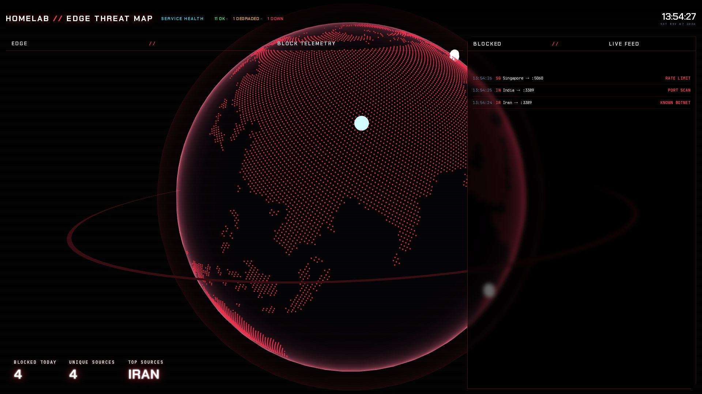

# MC2 · Edge

MC2 is the edge threat map. A full-screen globe with animated arcs sits behind a service health strip and two edge
panels. The header title comes from `config.json` `title` and defaults to `HOMELAB`.

## Panels

- Globe: a full-viewport globe with a land mask, great-circle arcs that land on a home beacon, impact pulses and an
  orbit ring.
  - It draws in 3D on a hardware WebGL renderer and as a 2D wireframe on a software renderer.
  - `?gl=3d` or `?gl=2d` forces either.
  - Reduced motion stops the arcs and the camera drift, and slows the blocked list.
- Service health: a header strip that counts apps OK, DEGRADED and DOWN across every app in `config.json` `groups`.
- Edge // block telemetry: blocked today, unique sources and top sources.
- Blocked // live feed: a scrolling list of blocked sources.

## Data

- `appScore`: the health score per app, for the service health strip.

The globe is decorative. The globe, edge stats and blocked list have no data source.

## States

- No feed:
  - The globe is decorative and does not show measured block data.
  - The edge stats and blocked list have no feed and show `No feed`.
- Service health:
  - Missing app scores show `—`; the strip does not fill them with other values.
  - With no scores, the panel records state `empty` and reads `NO SERVICE DATA`, or `NO APPS CONFIGURED` when the
    groups list is empty.
- Service health after a failed score query:
  - With no held scores, the panel records state `error` and reads `SCORE QUERY FAILED`.
  - With held scores, it keeps them and records state `stale`.
- Pending, Idle, NO DATA and Unavailable: not used on MC2.
