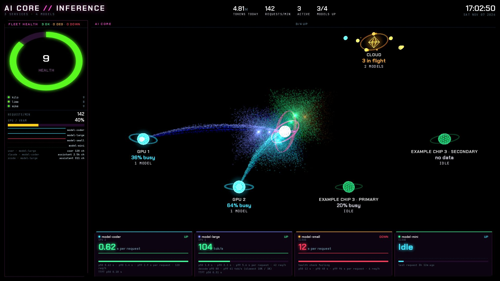

# MC3 · AI Core

MC3 is the AI inference core. A hub with four device nodes and a cloud node fills the screen, and each router model
hangs off the device that serves it. A fleet health column sits on the left, and a strip of model cards runs along
the bottom.

## Panels

- Header: `AI CORE // INFERENCE`, a subtitle with service and model counts, four key figures and a clock.
  - The key figures are tokens today in millions, requests per minute, active requests, and models up out of listed
    models.
  - Active is the router-wide count of requests in flight.
- Fleet health: the AI services and their health scores, with a ring that shows their mean score.
  - It lists only services whose health-check group is `AI · UI` or `AI · API`.
  - Seven or more services use two compact columns, so the whole list and the readings below it fit the panel.
  - The title counts services OK, DEG (degraded) and DOWN.
  - Below the list: requests per minute, a graphics processing unit (GPU) tile with the mean accelerator busy
    percent, one sparkline per model, and a list of recent requests.
- Reactor: the hub, its five nodes, and the models attached to them.
  - The cloud node sits top right, and the four device nodes sit below the hub.
  - The device nodes are `gpu-primary`, `gpu-secondary`, `mac-primary` and `mac-secondary`.
  - A model attaches to the first device whose host matches one of the model's serving URLs. A model whose URLs name
    no device attaches to the cloud node.
  - Each device label shows its name, busy percent, attached models and active requests.
  - A device name comes from its exporter's product label, or from `config.json` `accelerators` when that sets one.
  - A product label shortens to its identifier: leading brand words go, the name ends at the first word with a digit,
    and one short suffix word stays. `VENDOR Brand ABC 1234 SUPER` reads `ABC 1234 SUPER`.
  - Two devices that would read the same also get their role tag.
  - The cloud label shows router-wide requests in flight minus those drawn on devices, and its model count.
  - Each listed model has one colour, assigned in name order, so it keeps that colour when its request rank changes.
    Its 3D core and stream, its 2D dot and sparks, and its card all use that colour.
  - A down model's 2D dot is dimmed with a red ring.
  - Each request in flight draws one bead, up to 12. Past that, beads pack into rings, up to 36, and a badge carries
    the true count.
  - A node dims when nothing is attached and nothing is in flight. A device with no busy series is always dim.
  - Each new row in the recent-request list launches a comet from its model to the hub.
  - The reactor draws in 3D with WebGPU on a hardware renderer, and in 2D on a software renderer. `?gl=3d` or
    `?gl=2d` forces either. After three lost GPU devices it stays in 2D.
- AI Core model cards: one row of up to 8 cards.
  - The cards list only models with real requests in the last 4 days. The router's own health-check caller does not
    count.
  - Cards are sorted by requests in the last hour, then by name.
  - Each card shows a colour swatch and a top border in the model's colour, the model name, `UP` or `DOWN`, its device,
    a large number, a sparkline and per-request numbers.
  - The large number is the engine's decode speed p50 (50th percentile) in tok/s where the engine reports it.
    Otherwise it is the router's request time p50 in seconds.
  - Below it: request time p50, p90 and p99 (50th, 90th and 99th percentiles), and requests per hour.
  - Where the engine reports decode speed, the card adds decode p90 and p99, labelled as the slowest 10% and 1%.
    "p90 104 tok/s" means 90% of requests decoded at least that fast.
  - The card adds time to first token (TTFT) p50 when that reading exists.
  - The sparkline follows the large number.

## Data

- `aiAppScore`: the health score per AI service, for the fleet health list and ring.
- `llmState`: the router deployment state per model. A model is `UP` below state 2.
- `llmUsed4d`: models with a real request in the last 4 days. Only these models get a card.
- `llmRequests1h`: real requests per model in the last hour, for the sort order, the requests-per-hour figure and
  Idle.
- `llmRequestP50`: request time p50 per model over the last hour, in seconds.
- `llmRequestP90`: request time p90 per model over the last hour, in seconds.
- `llmRequestP99`: request time p99 per model over the last hour, in seconds.
- `llmTtftP50`: TTFT p50 per model over the last hour, in seconds.
- `llmDecodeP50`: the engine's per-request decode speed p50 per model over the last hour, in tok/s.
- `llmDecodeP90`: decode speed at the slowest 10% of requests, in tok/s.
- `llmDecodeP99`: decode speed at the slowest 1% of requests, in tok/s.
- `llmLastRequest`: the time of each model's last real request, for the Idle age.
- `llmTokRate`: output tok/s per model over 5 minutes, for the reactor's streams.
- `llmTokensToday`: router tokens over 24 hours, for the tokens-today figure.
- `llmReqPerMin`: router requests per minute over 5 minutes.
- `acceleratorBusy`: busy percent per accelerator role, for each device label and the GPU tile.
- `gpuModel`: each GPU device's role, product name and host.
- `macChip`: each `mac-*` device's role, chip name and host.
- `llmApiBase`: each model's serving URLs, matched against the device hosts.
- `vllmRunning`: requests running per vLLM server, drawn on its device.
- `llamaRunning`: requests processing per llama.cpp server, drawn on its device.
- `routerInFlight`: requests in flight across the whole router.

The recent-request list reads `/api/llm/recent` every 5 seconds. Its contract is in
[the runtime contract](runtime-contract.md).

## States

- Idle:
  - A model with no request in the last hour reads `Idle`, with its last-request age.
  - An idle model's sparkline leaves a gap, never a zero.
  - A device with nothing attached and nothing in flight reads `idle`. So does the cloud node with nothing in flight.
- NO DATA:
  - A device with no busy series reads `no data`.
  - The GPU tile reads `NO FEED` when no accelerator reports.
  - The request list reads `NO FEED` when `/api/llm/recent` fails, and `NO RECENT REQUESTS` when it answers empty.
- Stand-in:
  - Before any router model arrives, sample models sit on the cloud node, and the cards carry
    `data-source="stand-in"`.
  - Each key figure uses a stand-in value while its own query is empty or failed. Active then shows the sum of the
    local servers' requests.
  - When `llmUsed4d` fails, the cards list every deployment instead, so one failed query never empties the strip.
- Pending, STALE and Unavailable: not used on MC3.
