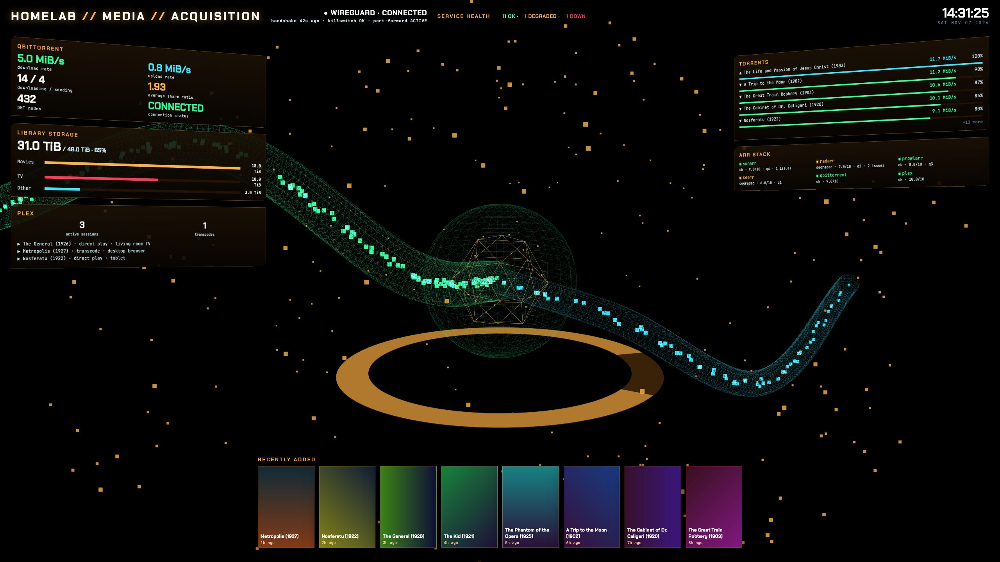

# MC4 · Media

MC4 is the media acquisition page. A 3D acquisition flow fills the screen behind telemetry cards for downloads,
library storage, playback and media services, with recent additions along the bottom. The header title comes from
`config.json` `title` and defaults to `HOMELAB`.

## Panels

- Header: `MEDIA // ACQUISITION`, VPN tunnel status, a service health strip and a clock.
  - The service health strip counts apps OK, DEGRADED and DOWN across every app in `config.json` `groups`.
- Left column:
  - `QBITTORRENT`: rates, torrent state counts, average share ratio, DHT nodes and connection status.
  - `LIBRARY STORAGE`: used and total `/data` capacity, Movies, TV and remaining Other storage.
  - `PLEX`: active sessions, transcodes and the now-playing sessions.
- Right column:
  - `TORRENTS`: five highest-rate torrents, progress and a `+N more` count for the remaining rows.
  - `ARR STACK`: sonarr, radarr, prowlarr, seerr, qbittorrent and plex, with app score and available queue and
    health counts.
- VPN line: WireGuard interface state, handshake age, killswitch state and port-forward state.
- `RECENTLY ADDED`: the eight newest Plex titles with age from their timestamps and gradient cards.
- Hero: a 3D acquisition flow.
  - Its brightness and spin follow the share of scored apps that are OK.
  - It draws in 2D on a software WebGL renderer. `?gl=3d` or `?gl=2d` forces either.

## Data

The page reads Prometheus vectors through `site/lib/prom.js` and `site/lib/queries.js`.

- `appScore`: per-app health score for the service strip, ARR rows and hero brightness.
- `media_qbit_*`: qBittorrent download rate, upload rate, DHT nodes and connection status.
- `media_torrent_*`: torrent progress, download and upload rates, share ratios and item state labels.
- `node_filesystem_size_bytes` and `node_filesystem_avail_bytes`: `/data` total and available capacity, each reduced
  with `max` across guests.
- `media_library_item_bytes`: library bytes summed by app. Radarr supplies Movies and sonarr supplies TV;
  Other is the unused remainder.
- `media_plex_active_sessions` and `media_plex_session`: active session count, decision labels and now-playing details.
- `media_arr_queue_records` and `media_arr_health_issues`: per-app queue and issue counts where series exist.
- `node_network_up` for `wg0`, `download_vpn_wg_last_handshake_timestamp_seconds`,
  `download_vpn_killswitch_ok` and `download_vpn_port_forward_active`: VPN line status.
- `media_plex_recently_added_timestamp_seconds`: title timestamps used to select the eight newest additions and
  calculate their ages.

Rates use binary `MiB/s`; storage uses binary `TiB`.

## States

- Each media card, the VPN line and the recently-added strip has its own `data-state`.
- `ok`: the panel has current metric data. A field without rows shows `NO FEED`.
- `stale`: a query failed and the panel is displaying values retained from its previous successful read.
- `error`: a query failed before that panel had a retained value for the failed feed.
- `empty`: the panel's queries succeeded and returned no rows.
- A successful query without media metrics shows `NO FEED`. A failed query shows `ERROR`.
- The service health strip shows `—` for missing scores and `NO SERVICE DATA` when it has no scores.
- Pending, `NO FEED` and `ERROR` describe missing readings; they are not metric values.
