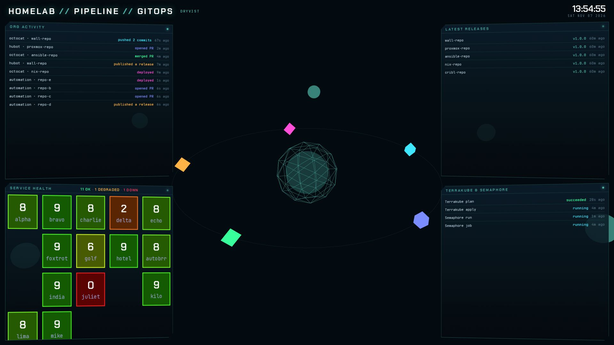

# MC5 · GitOps

MC5 is the GitOps pipeline overview for the `dryvist` GitHub organization. A 3D organization core with orbiting
repository nodes fills the screen, and comets fly through push, pull request, merge, release and deploy. Four cards
float over it. The header title comes from `config.json` `title` and defaults to `HOMELAB`.

## Panels

- Header: `PIPELINE // GITOPS`, the organization name and a clock.
- Hero: the organization core, a ring of up to 14 repositories, and comets.
  - The repositories are the organization's public ones, most recently pushed first.
  - Each new organization event sends a comet. Push, pull request, merge, release and deploy events fly to their own
    stage.
  - It draws in 2D on a software WebGL renderer. `?gl=3d` or `?gl=2d` forces either.
- Org activity: a ticker of the organization's 14 newest events, each with actor, repository, action and age.
- Service health: an app grid in `config.json` group order, with one empty cell between groups.
  - The title counts apps OK, DEGRADED and DOWN.
- Latest releases: the latest release tag and age for each of the 5 most recently pushed repositories.
- Terrakube & Semaphore: four plan, apply, run and job rows that cycle through queued, running and succeeded.

## Data

- `appScore`: the health score per app, for the service health grid.

MC5 also calls the public GitHub application programming interface (API) straight from the browser, with no token,
for the organization's events, repositories and releases.

- Events: polled at the interval the API asks for, never more often than once a minute.
- Repositories: public repositories sorted by last push, polled hourly.
- Releases: the latest release of each of the top 5 repositories, read after each repository poll.
- Every call sends a conditional request with the last ETag, and every response is cached in `localStorage`.

## States

- Stand-in:
  - When the API is unreachable and nothing is cached, generic repositories and events stand in, so the hero and
    ticker keep moving.
  - Releases fall back to generated tags when no repository has a release.
  - The Terrakube & Semaphore rows are always stand-in.
  - Each stand-in panel carries `data-source="stand-in"`. Nothing on screen marks it.
- Service health: with no scored app, the grid shows sample scores, marked `data-source="stand-in"`, and records
  state `empty`.
- Pending, Idle, STALE, NO DATA and Unavailable: not used on MC5.
