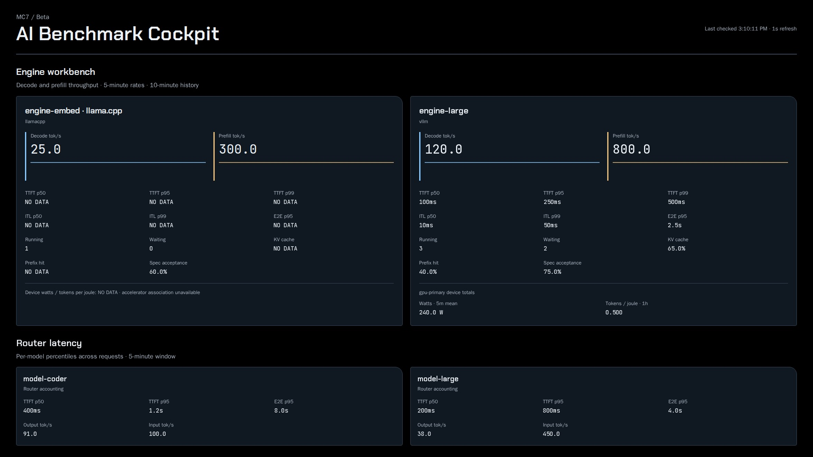

# MC7 · AI Benchmark Cockpit

MC7 is the AI Benchmark Cockpit, a beta page. Engine cards show what each inference engine measures, and router
cards show per-model latency from real requests as the router records it. The rotator names this slide `AI Benchmark Cockpit`.

## Panels

- Header: `MC7 / Beta`, the title, and a status line.
- Engine workbench: one card per engine model.
  - Engine cards show decode and prefill counter rates over 5 minutes, with timestamped, gap-preserving history over
    the last 10 minutes.
  - Each card also shows latency percentiles, concurrency, cache usage, prefix hits, and speculative acceptance.
  - The latency percentiles are time to first token (TTFT) p50, p95 and p99, inter-token latency (ITL) p50 and p99,
    and end-to-end (E2E) p95.
  - Concurrency is requests running and waiting. Cache usage is the key-value (KV) cache percent.
  - A card titled `<guest> · llama.cpp` is a llama.cpp engine, named by its guest.
- Device totals: under each engine card, one block per associated accelerator.
  - Device watts use a 5-minute mean.
  - Tokens/joule divides the recorded hourly generation rate by hourly mean power.
  - These are device totals, shown only when an engine exposes an accelerator association, not per-model power
    allocations.
- Router latency: one card per model with a real request in the last 4 days (`llmUsed4d`).
  - Router readings exclude the router's own health-check caller.
  - A listed model with no readings keeps its card, which reads `NO DATA`.
  - When `llmUsed4d` fails, the section lists every model it has readings for.
  - Router cards use LiteLLM `_bucket` histograms for TTFT p50/p95 and E2E p95, aggregated per model.
  - Each router card also shows output and input tok/s over 5 minutes.
  - An engine that reports only through the router has a router card and no engine card, so its engine-level cache
    and latency breakdowns stay unavailable.
- Footer: what TTFT, ITL and E2E mean, and that power and efficiency are device totals.

Engine histograms also use standard `_bucket` names. Percentiles come from bucket increases over the trailing
5 minutes, which also count a new series' first small bucket counts.

## Data

- `engineDecode`: decode tok/s per engine model over 5 minutes. Also read as a 10-minute range at 15-second steps.
- `enginePrefill`: prefill tok/s per engine model over 5 minutes. Also read as a 10-minute range at 15-second steps.
- `engineTtftP50`: engine TTFT p50.
- `engineTtftP95`: engine TTFT p95.
- `engineTtftP99`: engine TTFT p99.
- `engineItlP50`: engine ITL p50.
- `engineItlP99`: engine ITL p99.
- `engineE2eP95`: engine E2E p95.
- `engineDevices`: which accelerator each engine model runs on.
- `engineRunning`: requests running per engine model.
- `engineWaiting`: requests waiting per engine model.
- `engineKvPercent`: KV cache usage percent.
- `enginePrefixPercent`: prefix cache hits as a percent of prefix cache queries.
- `engineSpecPercent`: accepted speculative tokens as a percent of draft tokens.
- `routerInput`: router input tok/s per model over 5 minutes.
- `routerOutput`: router output tok/s per model over 5 minutes.
- `llmUsed4d`: models with a real request in the last 4 days.
- `routerTtftP50`: router TTFT p50 per model.
- `routerTtftP95`: router TTFT p95 per model.
- `routerE2eP95`: router E2E p95 per model.
- `acceleratorWatts`: mean power per accelerator over 5 minutes.
- `acceleratorTokensPerJoule`: the hourly generation rate per accelerator divided by its hourly mean power.

Each reading has a source-age key that returns the last sample time of its raw series. Percentiles that share a
histogram share its source-age key.

- `engineDecodeSourceAge`: for `engineDecode`.
- `enginePrefillSourceAge`: for `enginePrefill`.
- `engineTtftSourceAge`: for the three engine TTFT percentiles.
- `engineItlSourceAge`: for the two engine ITL percentiles.
- `engineE2eSourceAge`: for `engineE2eP95`.
- `engineDevicesSourceAge`: for `engineDevices`.
- `engineRunningSourceAge`: for `engineRunning`.
- `engineWaitingSourceAge`: for `engineWaiting`.
- `engineKvSourceAge`: for `engineKvPercent`.
- `enginePrefixSourceAge`: for `enginePrefixPercent`, the older of its two inputs.
- `engineSpecSourceAge`: for `engineSpecPercent`, the older of its two inputs.
- `routerInputSourceAge`: for `routerInput`.
- `routerOutputSourceAge`: for `routerOutput`.
- `routerTtftSourceAge`: for the two router TTFT percentiles.
- `routerE2eSourceAge`: for `routerE2eP95`.
- `acceleratorWattsSourceAge`: for `acceleratorWatts`.
- `acceleratorTokensPerJouleSourceAge`: for `acceleratorTokensPerJoule`, the older of tokens and power.

The page polls every `config.json` `refreshSeconds`, 15 seconds by default and at least 1 second. Each request
times out after 10 seconds.

## States

- NO DATA:
  - Missing measurements show `NO DATA`.
  - A section with no cards reads `NO DATA`, and records `error` when the poll failed or `empty` when it did not.
  - An engine with no accelerator association reads `Device watts / tokens per joule: NO DATA`.
- STALE:
  - A failed poll keeps each last measured value with its source sample time, and the tooltip shows that time, not
    the poll time.
  - A reading shows `STALE` with its age once that source sample is more than 5 minutes old, or when no source time
    is available.
  - A held value keeps the source time of its last measurement, and a reading unmeasured for an hour leaves the page.
  - A history sparkline that is held over shows its own `STALE` age.
- Idle: a percentile has no row when its window holds no requests. It reads `Idle` while its source is fresh.
- Unavailable: a reading with no source time has the tooltip `Measurement time unavailable`.
- The status line reads one of:
  - `Waiting for telemetry` before the first poll;
  - `Configuration unavailable · retrying` when `config.json` fails;
  - `Telemetry refresh failed · retrying` when a poll throws;
  - `Telemetry incomplete · held readings keep their measured time` when some queries failed;
  - `Telemetry stale · readings older than 5 minutes or measurement time unavailable`;
  - otherwise `Last checked <time> · <N>s refresh`.
- Pending: each section starts `pending` until the first poll.
