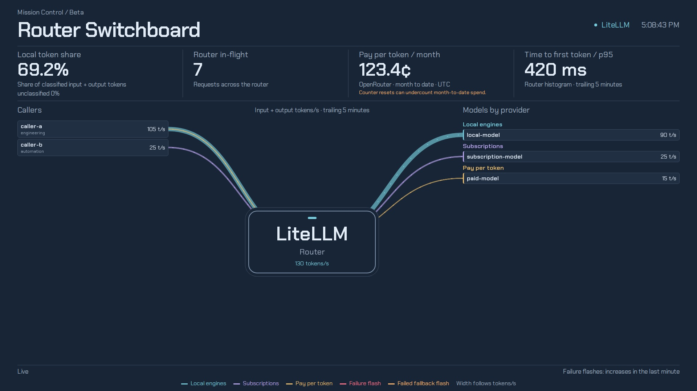

# MC8 · Router Switchboard

MC8 is the Router Switchboard, a beta page. It draws token flow from each caller, through the router, to each
model, grouped by billing class. Four router readouts sit above it, with request rate, latency, recent outcomes,
and the most requested models displayed inside the router hub. MC8 uses real measurements only. The rotator names
this slide `SWITCHBOARD`.

## Panels

- Readouts:
  - Local and cloud values stay separate throughout the page; it does not display a combined local-plus-cloud total.
  - Local token rate: local input and output tokens per second, with the unclassified share of cloud traffic shown
    separately.
  - Router in-flight: requests in flight across the router.
  - Pay per token / month: provider spend in cents since the month boundary in Coordinated Universal Time (UTC).
  - Time to first token / p95: local and cloud router times to first token (TTFT) p95 (95th percentile) over the
    trailing 5 minutes, in milliseconds.
- Router hub measurements:
  - Requests per minute by local and cloud billing class, calculated from a 5-minute request-counter rate.
  - Request latency p50 and p95 by class over 5 minutes, calculated from histogram bucket increases.
  - Failure responses and failed fallbacks by class over 15 minutes.
  - Up to five models per class by request count over the last hour.
  - Each measurement shows pending, live, stale with age, error with its message, or idle when its source is fresh
    and its result has no samples. Measured zeroes remain visible.
- Pinned callers: optional `config.json` `mc8PinnedCallers` array. A string pins that `api_key_alias`; an object
  `{ "name": ..., "match": ... }` groups every alias its glob (`*` wildcard) matches into one row under `name`. An alias
  pinned by its exact name keeps its own row. A pinned row with no request series reads `no requests yet`.
- Switchboard: callers on the left, the router hub in the middle, and models by provider on the right.
  - Routes retain caller alias and team, model, and provider labels.
  - Token rates exclude the router's own health-check caller.
  - The page fits one screen. A column that cannot fit shows its top rows plus one collapsed row with their local
    and cloud rates apart. The model column's collapsed row reads `+N local · +M cloud`.
  - Routes to a collapsed caller or model end at its collapsed row, one route per class.
  - Width means input plus output tokens/s over 5 minutes.
  - Focus or hover a caller or model to trace its paths.
  - Caller rates, collapsed rows, route status, and readouts keep local and cloud values separate. A missing class
    is omitted; a measured zero remains visible.
- Billing banks: models sit in banks for local engines, subscriptions, pay per token, free, and unclassified.
  - A bank with no measured model draws nothing.
  - Billing banks use the token series' `tag_telemetry_billing_class_` labels: `local`, `subscription`, `paid`, and
    `free`, when their string value is `true`.
  - Series with all flags false or missing remain Unclassified; provider names never determine billing.
  - Rates retain these labels through aggregation.
- Failure flashes:
  - Failure flashes apply to model edges with measured failure or failed-fallback increases over the last minute.
  - Those counters do not establish caller attribution.
  - A collapsed row carries the failure markers of the models collapsed into it.
  - Model failure markers also appear at zero token throughput; failure-only models show `No token rate` rather
    than a made-up zero.
  - Failure and failed-fallback indicators cover the one-minute window that ends at each result's evaluation time,
    and expire 75 seconds after it.
  - Past 25 seconds the marker names how long ago that window ended.
- Footer and legend: the flow and failure status lines, and the colour of each bank and flash.

## Data

- `mc8InputRate`: input tok/s over 5 minutes, by caller alias, team, model, provider and billing class.
- `mc8OutputRate`: output tok/s over 5 minutes, grouped the same way.
- `mc8InputSourceTime`: the last sample time of each raw input token counter, grouped the same way.
- `mc8OutputSourceTime`: the last sample time of each raw output token counter, grouped the same way.
- `mc8InFlight`: requests in flight across the router.
- `mc8InFlightSourceTime`: the last sample time of the in-flight series. MC8 uses it as router liveness.
- `mc8TtftLocalP95` and `mc8TtftCloudP95`: local and cloud router TTFT p95 over 5 minutes.
- `mc8TtftLocalSourceTime` and `mc8TtftCloudSourceTime`: last sample times of their TTFT histograms.
- `mc8RequestsPerMinute`: request rate per local billing tag over 5 minutes; all non-local rows are cloud.
- `mc8RequestsSourceTime`: raw request counter sample time grouped by billing class.
- `mc8RequestLatencyLocalP50`, `mc8RequestLatencyCloudP50`, `mc8RequestLatencyLocalP95` and
  `mc8RequestLatencyCloudP95`: request latency p50/p95 per class over 5 minutes, from bucket increases.
- `mc8RequestLatencyLocalSourceTime` and `mc8RequestLatencyCloudSourceTime`: raw request histogram sample times.
- `mc8Failures15m` and `mc8Fallbacks15m`: failure responses and failed fallbacks by local billing tag over 15
  minutes; every other billing row is cloud.
- `mc8Failures15mSourceTime` and `mc8Fallbacks15mSourceTime`: source sample times for the 15-minute counters.
- `mc8TopModelsLocal` and `mc8TopModelsCloud`: up to five models per class by request count over one hour, using
  the `+Inf` request latency histogram bucket.
- `mc8TopModelsLocalSourceTime` and `mc8TopModelsCloudSourceTime`: raw request histogram sample times by model.
- `mc8Failures`: failure responses per model and provider over the last minute.
- `mc8FailuresSourceTime`: the last sample time of the failure counters.
- `mc8Fallbacks`: failed fallbacks per model and provider over the last minute.
- `mc8FallbacksSourceTime`: the last sample time of the failed-fallback counters.
- `mc8SpendCents`: provider spend in cents since the UTC month boundary.
- `mc8SpendSourceTime`: the newest sample time of any router spend series.

TTFT p95 and request latency p50/p95 use standard router histogram buckets. They come from bucket increases, which
also count a new series' first small bucket counts. Request latency does not use the histogram `_count` or `_sum`
series. New MC8 measurements exclude the `litellm-internal-health-check` caller.

Spend shows cents since the UTC month boundary: each series' rise over its month-start baseline, clamped at zero,
then summed. Counter resets can still undercount month-to-date spend, and the page says so.

Token-rate freshness uses the raw input and output counter sample times, grouped by caller, team, model, provider and
billing class. In-flight, TTFT, failure and fallback freshness use their raw series' sample times. Spend freshness
uses the newest sample of any router spend series, since a provider's spend series exists only after use.

The page polls every `config.json` `refreshSeconds`, 15 seconds by default and at least 1 second. Each request
times out after 10 seconds.

## States

- Pending: failed queries, and empty ones not covered below, show `Pending` until the first reading. A reading never
  measured shows `Pending`, even when its sources are stale.
- Unavailable: a share that cannot be computed shows `Unavailable`.
- STALE:
  - Later gaps retain the last measurement with a visible `STALE` age.
  - Measurements older than 5 minutes, more than 5 seconds ahead, or without a valid timestamp are stale, even after
    a successful snapshot refresh.
  - The unclassified percentage has its own stale state from the same token-rate sample times.
  - Stale failure readings never trigger flashes.
- Idle:
  - An empty TTFT result reads `Idle` while the histogram's sample time is fresh.
  - The router hub reads `Idle` when a new measurement has no result and its source or router liveness is fresh.
  - Zero token rate means idle.
- Hub insight errors show the failed query's message. A retained reading from a failed refresh shows stale age and
  the query message.
- Zero: an empty failure, fallback or spend result reads as zero while the router is live, meaning the in-flight
  sample time is fresh.
- Unavailable:
  - Without local traffic the local token rate shows `Unavailable`.
- NO DATA: not used on MC8.
