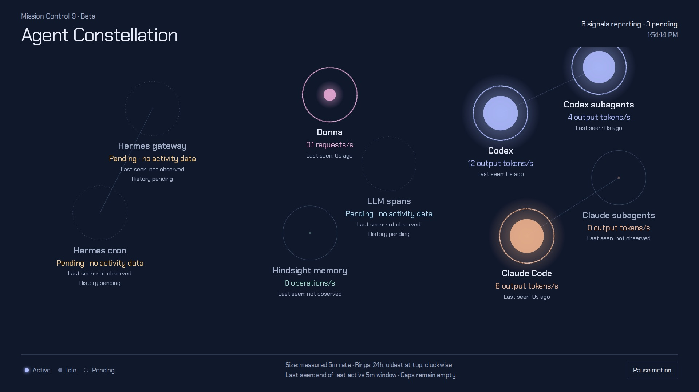

# MC9 · Agent Constellation

MC9 is the Agent Constellation, a beta page. Each AI agent signal is a node in a sky, sized by its measured 5-minute
rate and ringed by its last 24 hours. The default rotator lists MC9 last, after MC8, and names it
`Agent Constellation`.

## Panels

- Header: `Mission Control 9 · Beta`, the title, a status line and a clock.
  - The status line counts signals reporting and signals pending, and adds `STALE data` when any node is stale.
- Constellation: nine nodes, each with its label, rate, unit, and a last-seen or state line.
  - Hermes gateway, in active agents, and Hermes cron, in running jobs.
  - Donna, in requests/s.
  - Hindsight memory, in operations/s.
  - Codex and Codex subagents, in output tokens/s.
  - Claude Code and Claude subagents, in output tokens/s.
  - Large language model (LLM) spans, shown as `No feed`.
- Footer: the legend (Active, Idle, Pending), how to read size and rings, and a `Pause motion` button.

Node rules:

- Codex groups `session_source` into primary and `subagent_*` activity.
- Claude Code groups `agent_name` into main (including an absent label) and subagents.
- Both show output tokens/s.
- Donna shows router requests/s for its key alias; Hindsight shows operations/s.
- The LLM spans node has no signal.
- Node area grows monotonically with the 5m rate, approaching its ring; signals have different units and are
  labelled.
- Rings show measured 5m rates over 24h (brightness relative to each node's own maximum), with timestamp gaps
  unfilled.
- Rings start at the top, oldest first, and run clockwise.
- Last seen is the end of the last positive activity window, with 5-minute resolution for historical samples; it is
  unknown when no activity was observed.
- Lines show agent grouping only.
- No host, session, or user identities appear.
- Pause and reduced motion stop glow animation.

## Data

MC9 uses only the Prometheus gateway or snapshot, with `mc9*` queries in `Q`.

- `mc9DonnaRate`: router requests per second for Donna's key alias, over 5 minutes.
- `mc9HindsightRate`: Hindsight operations per second, over 5 minutes.
- `mc9CodexRate`: Codex output tokens per second, split into primary and subagents.
- `mc9ClaudeMainRate`: Claude Code main-agent output tokens per second.
- `mc9ClaudeSubagentRate`: Claude Code subagent output tokens per second.
- `mc9GatewayAgents`: active agents across gateway instances, each at its 5-minute peak.
- `mc9CronJobs`: running cron jobs across gateway instances, each at its 5-minute peak.

Each key is read as a current value and as a 24-hour range at 5-minute steps.

- History refreshes every 5 minutes; current rates follow `refreshSeconds`.
- Requests time out after 10 seconds.

## States

- MC9 never substitutes sample values.
- Pending:
  - Missing signals stay visible as pending.
  - An empty 24h ring is pending.
- No feed: the LLM spans node shows `No feed` and the status line counts it.
- STALE:
  - A signal that disappears or fails retains its last measured value as STALE.
  - Current readings become stale after 300 seconds even during an unfinished poll.
  - History becomes stale when its refresh fails or its last successful refresh is over 10 minutes old.
  - Stale history marks the page header only where its ring is drawn.
  - A series that has gone quiet keeps current history.
- Idle:
  - Zero means a measured idle rate.
  - A subagent series exists only while a subagent works, so a satellite without its own row reads zero, at its
    parent's sample time, while the parent reports.
- NO DATA and Unavailable: not used on MC9.
